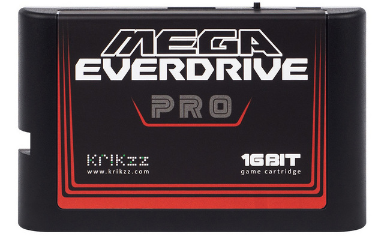

# Mega EverDrive PRO/CORE Dev Sources

This repository contains libraries, tools and code examples for development targeting Mega EverDrive PRO/CORE.

## Contents

| Path | Description |
|---|---|
| [`/edio`](edio/) | Examples of low level cartridge hardware access: SD card, USB, memory, FPGA registers, etc. |
| [`/edio-cmd`](edio-cmd/) | USB command scripts for the `/edio` application. |
| [`/fpga`](fpga/) | FPGA mapper examples and reference projects. |
| [`/usb-cmd`](usb-cmd/) | Example USB scripts for communication with EverDrive. |
| [`/edapp`](edapp/) | MegaColor player sources. Shows how to build applications which handle specific file types. |
| [`/edlink.py`](edlink.py) | Basic cross-platform launcher script for `edlink.exe`. Requires Mono runtime on Linux and macOS. |
| [`/edlink.exe`](edlink.exe) | USB utility for communication with EverDrive over USB. |
| [`/extended-ssf.md`](extended-ssf.md) | Extended-SSF mapper specification. |

---

    

